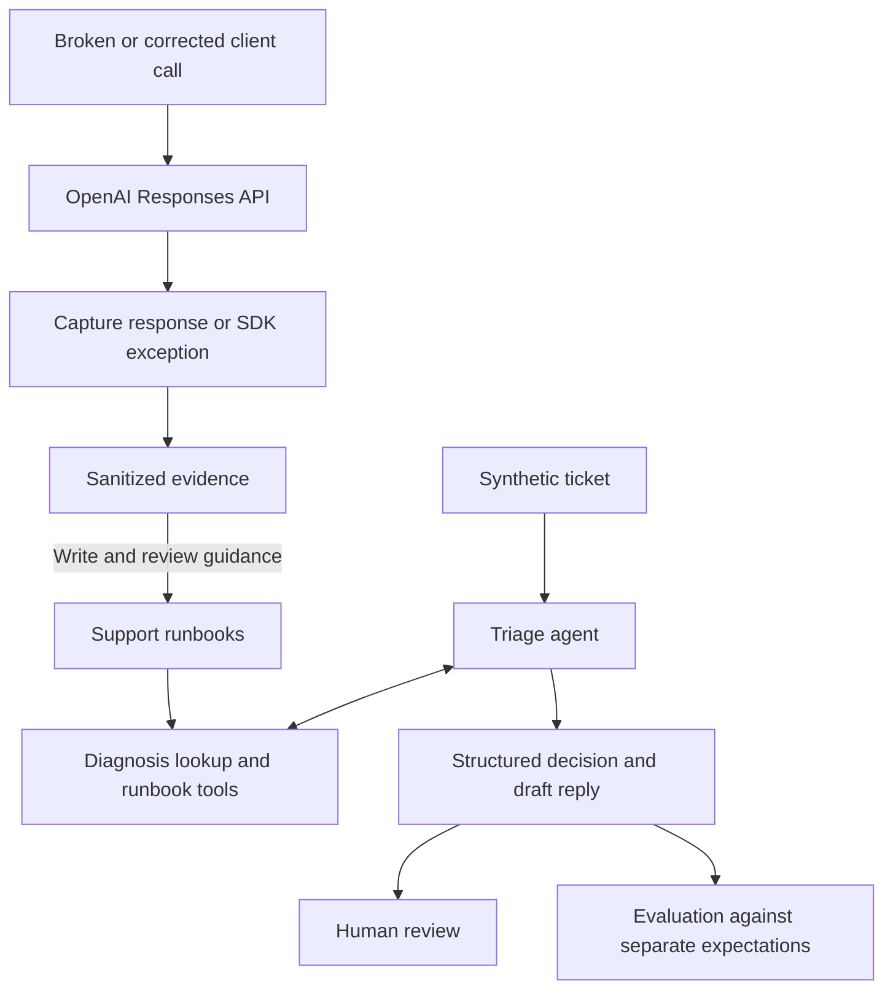

# API Support Lab

A Python project that reproduces four OpenAI API failures against the live API, documents each in a support runbook, and runs a triage agent that uses those runbooks to draft replies to synthetic support tickets. Every reply is a draft for human review.

Built on the OpenAI Responses API and the Agents SDK (`openai-agents`), with Codex as the pair-programming assistant.

The saved reproductions and agent runs used `gpt-6.1-sol` (`openai` 3.36.0; the agent also used `openai-agents` 0.24.0). The reproduction captures are dated 2026-10-22 UTC; the agent runs are dated 2026-10-22 America/New_York.

## A saved example

A synthetic ticket reports: “The API returned HTTP 200, but our JSON parser failed.” The nightly report is blocked, and completion details have not been saved.

The agent retrieved the incomplete-output runbook and returned these fields:

```json
{
  "category": "incomplete_output",
  "basis": "inferred",
  "severity": "high",
  "action": "request_info"
}
```

Its saved reply begins:

> HTTP 200 confirms a response arrived, but not that its output was complete. The parser error alone does not establish token-budget exhaustion; extraction or parsing problems are also possible.

The category is a hypothesis; the severity comes from the blocked report; the next step is to collect completion details and a sanitized failing excerpt.

This is an excerpt from [T-006](triage/tickets/T-006.yaml) in its [saved run](evidence/triage/runs/T-006.json), not a newly generated response. The [walkthrough](docs/walkthrough.md) follows this example alongside a supported correction and an escalation.

## What is implemented

| Case | Synthetic reproduction setup | Observed result (live, 2026-10-22 UTC) | Runbook |
| --- | --- | --- | --- |
| Invalid credentials | Deliberately invalid API key | HTTP 401 `AuthenticationError`, code `invalid_api_key` | [invalid_credentials](runbooks/invalid_credentials.md) |
| Malformed tool schema | `"type": "not_a_json_schema_type"` in a strict function tool | HTTP 400 `BadRequestError`, code `invalid_function_parameters`, param `tools[0].parameters` | [tool_schema](runbooks/tool_schema.md) |
| Incomplete structured output | `max_output_tokens: 128` for a 32-item JSON-schema workload | HTTP 200 with `response_status: incomplete`, `incomplete_reason: max_output_tokens` | [incomplete_output](runbooks/incomplete_output.md) |
| Client timeout | 0.5-second client timeout, zero retries | `APITimeoutError` after about 620 ms; no HTTP status, request ID, or usage | [timeout](runbooks/timeout.md) |

The table combines request setup from the [case implementations](src/api_support_lab/cases/) with observed fields from the captures linked in each runbook.

For ticket triage, one agent uses three read-only tools and returns a structured decision plus a draft reply. Its [saved outputs](evidence/triage/runs/) for the ten tickets are in the repo, one file per ticket.

The four cases cover two errors with a diagnostic code to look up (401 and 400), an HTTP-success response whose output is incomplete, and a client timeout without a received response. In two of the four, the status code alone does not tell you what went wrong.

The failure scope was kept deliberately small to leave more time for the triage agent and ticket-based testing. Rate limits, quota, model access, and context overflow are out of scope, as are MCP, hosting, and external ticketing.

The shared tools are ordinary Python functions: `diagnose`, `list_runbooks`, and `get_runbook`. Exact diagnostic matches come from reviewed observations. Unknown codes remain unmatched, and symptom-based retrieval supports cases without a diagnostic status/code mapping.

## Quick start

Needs Python 3.14 and [uv](https://docs.astral.sh/uv/getting-started/installation/) on your `PATH`; uv can fetch Python if needed. Run these commands from a checkout:

```sh
uv sync --locked
uv run python -m api_support_lab diagnose --status 401 --error-code invalid_api_key
uv run pytest -q
uv run python -m api_support_lab evaluate --results evidence/triage/runs
```

None of these commands need an API key. `diagnose` prints `["invalid_credentials"]`, a candidate for investigation. Tests use dummy credentials and an in-memory transport; a pytest DNS/socket guard blocks unexpected network access during offline execution. `evaluate --results` scores the saved outputs against `triage/expected.yaml` without calling the model and prints 10/10. It does not rerun the agent. Generated files go under ignored `artifacts/`. The fully locked-down command forms are in the [reproduction guide](docs/reproduction-guide.md#offline-checks-and-references).

For a live draft, copy `.env.example` to `.env`, configure your own project key, and explicitly load it:

```sh
uv run --locked --env-file .env python -m api_support_lab triage triage/tickets/T-006.yaml --live
```

The application does not automatically load `.env`; it is ignored by Git. Live commands require `--live` and may incur charges. The agent reads runbooks and drafts replies; it cannot send messages, run reproductions, or change accounts. Review every draft before use.

## How it works



Capture keeps the diagnostic fields, effective settings, a bounded output excerpt, and available usage. Code checks the shape of the result, that any runbook the agent cites was actually retrieved, and that lookup arguments came from the ticket. Whether the prose is right is still a person's call.

Three rules shape the agent:

- It passes only ticket-stated status/code values to `diagnose`. For [T-005](triage/tickets/T-005.yaml), the customer's authentication suspicion supplies neither; the saved agent run lists runbooks, retrieves credential guidance, and asks for diagnostics instead of guessing a lookup code.
- It must retrieve supporting guidance before recommending a case-specific fix. A result referencing a runbook it never retrieved is rejected.
- `basis` records whether supplied diagnostics directly support the category (`stated`), symptoms support a hypothesis (`inferred`), or no supported category is determined (`none`). For [T-008](triage/tickets/T-008.yaml), pasted schema diagnostics take precedence over the customer's authentication claim.

## Results and limits

Each case has one reviewed live broken/corrected pair — a reproduction, not a benchmark.

The agent's saved outputs for the ten tickets are in [`evidence/triage/runs/`](evidence/triage/runs/), one file per ticket, with notes on each draft in [`owner-review.md`](evidence/triage/owner-review.md). They score 10/10 against the expected decisions. The instructions were tuned against these same hand-authored tickets — the [development notes](docs/development-notes.md#tuning-the-agent) say how — so this shows the loop works, not how reliable the agent is.

The runbooks were edited after this run to add quoted errors and revise sample replies; the saved outputs used the earlier text, and the agent has not been rerun with the revised guidance.

The offline tests (279, mostly parametrised) cover capture, redaction, tool schemas, the agent loop against an in-memory transport, and scoring. They test the software, not the quality of a live reply. All organizations and tickets are invented.

## Explore further

- [Walkthrough](docs/walkthrough.md): four saved decisions, actual replies, and a code-reading path.
- [Development notes](docs/development-notes.md): project attribution, the design calls, and how the agent was tuned.
- [Architecture](docs/architecture.md): components, interfaces, and design tradeoffs.
- [Reproduction guide](docs/reproduction-guide.md): running the cases and publishing evidence.
