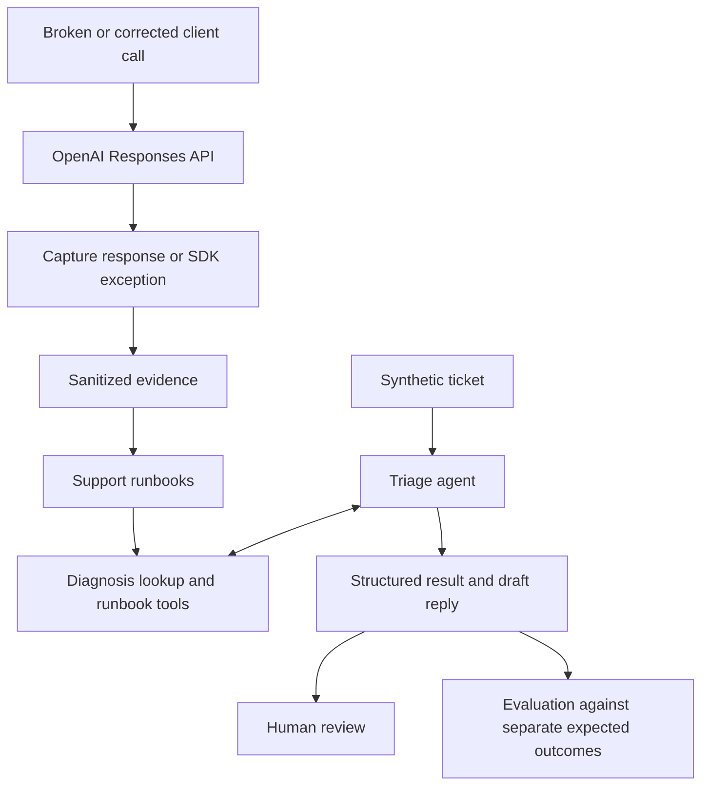

# API Support Lab

A Python learning lab for reproducing API failures, developing support runbooks, and evaluating agent-assisted ticket triage.

**Status: slice 2 complete.** The package, configuration, live-operation boundaries, sanitized capture wrapper, and broken/corrected authentication commands are available. The [authentication runbook](runbooks/invalid_credentials.md) has one reviewed live pair: HTTP 401 with `invalid_api_key` for the broken request, then HTTP 200 with completed output `READY` for the correction. Verified live cases: **1 of 4**. The remaining cases, diagnosis tools, agent, evaluation, and walkthrough remain planned.

## Learning goals

- Reproduce common failures against the OpenAI API and collect useful diagnostic evidence.
- Distinguish similar symptoms without assuming that an HTTP status identifies the cause.
- Write runbooks with practical fixes, clear customer replies, and escalation checklists.
- Explore function tools and structured agent outputs, including when to ask for more information.
- Evaluate drafts against synthetic tickets and make limitations visible.

## Intended workflow



Live reproductions will use the real API. Only the client mistake and customer ticket are synthetic. Saved evidence will support offline checks; the triage agent will read runbooks and draft replies for a person to review.

## Initial cases

| Case | Intended experiment | Corrected behavior |
| --- | --- | --- |
| Invalid credentials | Make a request with an intentionally invalid credential | Repeat the request using a valid environment-provided credential |
| Malformed tool schema | Send an invalid function-tool schema | Send a supported schema for the same task |
| Incomplete structured output | Restrict the output budget until the response is incomplete | Use a sufficient bounded budget and verify completion and parsed output |
| Client timeout | Set an impractically short client timeout | Use a suitable timeout for the same bounded request |

The authentication observations are linked in its runbook; the other cases remain unverified. Each case will have a runbook and an honest reproduction status. The invalid-credential experiment does not establish that a particular key was revoked.

The first release also targets one agent, three read-only tools, and ten synthetic evaluation tickets. Context overflow, model-access failure cases, rate limits, and quota exhaustion are deferred.

## Illustrative example

This example describes intended behavior; it is not a captured API response or an executed agent result.

**Ticket:** “The API returns HTTP 200, but our JSON parser sometimes fails. The nightly report is blocked.”

**Expected approach:** retrieve the incomplete-output runbook, retain output exhaustion as a hypothesis, and ask for the response completion status, incomplete reason, configured output limit, and a sanitized failing excerpt. Other causes remain possible.

**Draft reply:** “Could you share the response status and incomplete details, the configured output limit, and a small sanitized example that fails to parse? That will help distinguish an incomplete response from a parsing issue.”

The result should use `request_info` and mark the diagnosis as inferred. HTTP success alone does not establish that the requested task completed.

## Setup and current usage

Use Python 3.14 and `uv`. Install the locked dependencies from the checkout:

```sh
uv sync --locked
uv run --offline --locked --no-env-file python -m api_support_lab --help
uv run --offline --locked --no-env-file pytest
```

Setup may download dependencies; the help command and default tests need neither network access nor credentials after setup. In this workspace, `uv` is installed locally at `.tools/uv`; use that executable in place of `uv` if it is not on your PATH. Local tooling and caches are ignored.

The CLI implements `reproduce invalid_credentials --variant broken|fixed --live`. Each invocation makes one request with retries disabled. The broken variant deliberately uses an invalid credential and does not load the environment key; the fixed variant uses `OPENAI_API_KEY`. Both use the same small synthetic workload. The implementation has offline checks and one reviewed live pair, observed on 2026-10-21 in America/New_York (2026-10-22 UTC). Live execution remains explicitly opted-in work.

Help returns exit code 0. For authentication reproduction, exit code 0 means that single attempt matched its expected behavior: an SDK authentication rejection with HTTP 401 for `broken`, or HTTP success with completed status and nonempty text for `fixed`. Other outcomes remain saved and return 1. Neither a single successful attempt nor HTTP 200 alone verifies the pair. Configuration/argument errors and missing live opt-in return 2. Other cases, diagnosis, triage, and evaluation still return 1 with an explicit `not implemented` message, without loading credentials or constructing clients. Saved-result scoring will use `evaluate --results PATH`, mutually exclusive with live evaluation.

Configuration defaults to `gpt-6.1-sol`, Responses, low reasoning, a 60-second request timeout, and no automatic retries. Authentication requests use a 2,048-token output cap and disable response storage with `store=False`; agent responses will use a 4,096-token cap and eight turns. `API_SUPPORT_LAB_MODEL` overrides the model. Credentials are loaded separately from `OPENAI_API_KEY` only when constructing an explicitly authorized live client that needs the environment credential; they are never stored in the settings object. The Agents SDK setup helper explicitly disables remote tracing. Importing the package or invoking CLI help creates no SDK client.

The application does not automatically load `.env`. Use `uv run --env-file .env` explicitly for a later authorized fixed request; `.env` is ignored by version control. Default tests need no credentials. `--no-env-file` prevents uv from loading an environment file for offline checks; uv's `--offline` controls dependency downloads and does not block an application's own network requests. The pytest network tripwire supplies that test boundary.

Capture stores only allowlisted diagnostic fields, bounded text output, selected usage counts, and effective request settings. It redacts the active credential plus recognizable key/bearer strings before truncating output or writing JSON. When a server error body exists, capture selects only its structured message field; a missing message stays null rather than falling back to a dump of the body. Missing HTTP fields stay null; refusals are distinct from completed text and incomplete responses. Programming mistakes propagate instead of being recorded as API failures.

Each attempt gets a separate timestamped, uniquely named JSON file under the checkout's ignored `artifacts/evidence/`. Optional `--output-dir PATH` overrides the directory. A failed expectation does not remove its artifact. Filesystem failures do not trigger another request. Review sanitization before deliberately selecting any observation for the public tree; redaction is not a guarantee that arbitrary sensitive content will be recognized.

Tests block DNS resolution and outbound socket connections inside offline test execution. Tests marked `live` are skipped unless `--run-live` is supplied; selecting the marker alone does not enable them. The current suite has no live API tests. Its opt-in checks use a harmless generated test; authentication tests use dummy credentials and an in-memory transport, including real SDK request serialization, parsing, and exception handling. All test artifacts stay in temporary directories and are never public evidence. The network tripwire is a pytest fixture, not a production guard framework or an OS network sandbox.

The environment and local interfaces were checked on Python 3.14.4 with uv 0.13.5, OpenAI SDK 3.36.0, Agents SDK 0.24.0, Pydantic 2.14.1, PyYAML 6.0.3, and pytest 9.1.1. Exact runtime and test dependencies are in `uv.lock`. Actual tool-schema generation is deferred until the tools exist.

Slice 2's live checkpoint is complete: one broken and one corrected request, both with zero retries; reviewed evidence is linked from the authentication runbook. The correction reported 13 input and 5 output tokens. Its standard-rate token estimate is $0.000076, not a confirmed billing charge; rejected-request usage and the remaining account balance are unknown. Review the billing dashboard before further live work. No real API key or `.env` contents were accessed during offline implementation; the key was subsequently loaded without display for the authorized live correction and artifact review. The next implementation slice adds deterministic tools and the initial three-ticket agent workflow.

The initial experiment budget is $15, with a target of 8–12 build hours. These are planning limits, not a cost estimate or an automatic billing guarantee. Live calls and agent runs may incur charges.

## Project documentation

- [Requirements](docs/requirements.md): capabilities, constraints, scope, and acceptance criteria.
- [Architecture](docs/architecture.md): components, interfaces, data handling, and design tradeoffs.
- [Implementation plan](docs/implementation-plan.md): build order, verification checkpoints, and cut lines.

All customer organizations and tickets will be invented. Evidence will be sanitized, and results will be presented as a small learning demonstration rather than a reliability benchmark. A future walkthrough will show a supported diagnosis, a request for missing evidence, and an escalation.

This project is being developed with Codex as a pair-programming assistant.
