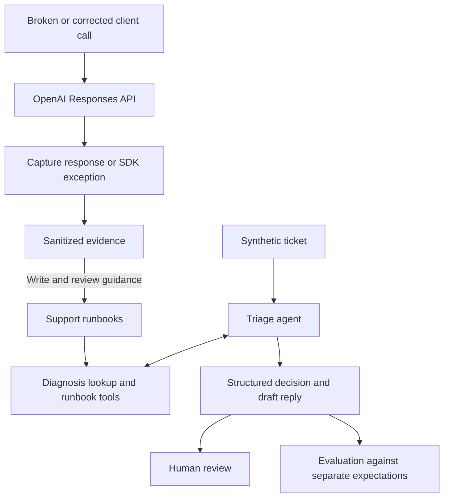

# API Support Lab

A Python project that reproduces four OpenAI API failures against the live API, documents each in a support runbook, and runs a triage agent that uses those runbooks to draft replies to synthetic support tickets. Every reply is a draft for human review.

Built on the OpenAI Responses API and the Agents SDK (`openai-agents`), with Codex as the pair-programming assistant.

## A saved example

A synthetic ticket reports: “The API returned HTTP 200, but our JSON parser failed.” The nightly report is blocked, and completion details have not been saved.

The agent retrieved the incomplete-output runbook and returned these fields:

```json
{
  "category": "incomplete_output",
  "basis": "inferred",
  "severity": "high",
  "action": "request_info"
}
```

Its saved reply begins:

> HTTP 200 confirms a response arrived, but not that its output was complete. The parser error alone does not establish token-budget exhaustion; extraction or parsing problems are also possible.

The category is a hypothesis. The blocked report supports high severity; the parser error does not establish the cause. The next step is collecting completion details and a sanitized failing excerpt.

This is an excerpt from [T-006](triage/tickets/T-006.yaml) in the [saved live evaluation](evidence/triage/ten-ticket-follow-up-20261022/reviewed-evaluation.json), not a newly generated response. The [walkthrough](docs/walkthrough.md) follows this example alongside a supported correction and an escalation.

## What is implemented

| Case | Synthetic reproduction setup | Observed result (live, 2026-10-22 UTC) | Runbook |
| --- | --- | --- | --- |
| Invalid credentials | Deliberately invalid API key | HTTP 401 `AuthenticationError`, code `invalid_api_key` | [invalid_credentials](runbooks/invalid_credentials.md) |
| Malformed tool schema | `"type": "not_a_json_schema_type"` in a strict function tool | HTTP 400 `BadRequestError`, code `invalid_function_parameters`, param `tools[0].parameters` | [tool_schema](runbooks/tool_schema.md) |
| Incomplete structured output | `max_output_tokens: 128` for a 32-item JSON-schema workload | HTTP 200 with `response_status: incomplete`, `incomplete_reason: max_output_tokens` | [incomplete_output](runbooks/incomplete_output.md) |
| Client timeout | 0.5-second client timeout, zero retries | `APITimeoutError` after about 620 ms; no HTTP status, request ID, or usage | [timeout](runbooks/timeout.md) |

The table combines request setup from the [case implementations](src/api_support_lab/cases/) with observed fields from the captures linked in each runbook.

For ticket triage, one agent uses three read-only tools and returns a structured decision plus a draft reply. The [ten-ticket evaluation](evidence/triage/ten-ticket-follow-up-20261022/README.md) preserves its saved results.

The four cases cover two errors with a diagnostic code to look up (401 and 400), an HTTP-success response whose output is incomplete, and a client timeout without a received response. Status alone does not settle the diagnosis across these cases.

The failure scope was kept deliberately small to leave more time for the triage agent and ticket-based testing. See [requirements](docs/requirements.md#scope-and-current-status) for the coverage boundaries.

The shared tools are ordinary Python functions: `diagnose`, `list_runbooks`, and `get_runbook`. Exact diagnostic matches come from reviewed observations. Unknown codes remain unmatched, and symptom-based retrieval supports cases without a diagnostic status/code mapping.

## Quick start

Needs Python 3.14 and [uv](https://docs.astral.sh/uv/getting-started/installation/) on your `PATH`; uv can fetch Python if needed. Run these commands from a checkout:

```sh
uv sync --locked
uv run python -m api_support_lab diagnose --status 401 --error-code invalid_api_key
uv run pytest -q
uv run python -m api_support_lab evaluate --results evidence/triage/ten-ticket-follow-up-20261022/reviewed-evaluation.json
```

None of these commands need an API key. `diagnose` prints `["invalid_credentials"]`, a candidate for investigation. Tests use dummy credentials and an in-memory transport; a pytest DNS/socket guard blocks unexpected network access during offline execution. `evaluate --results` rescores the saved report against current expectations without calling the model and prints **10/10 automated agreement**, with zero operational failures and zero semantic mismatches. It does not rerun the agent. Generated files go under ignored `artifacts/`. The fully locked-down command forms are in the [reproduction guide](docs/reproduction-guide.md#offline-checks-and-references).

For a live draft, copy `.env.example` to `.env`, configure your own project key, and explicitly load it:

```sh
uv run --locked --env-file .env python -m api_support_lab triage triage/tickets/T-006.yaml --live
```

The application does not automatically load `.env`; it is ignored by Git. Live commands require `--live` and may incur charges. The agent reads runbooks and drafts replies; it cannot send messages, run reproductions, or change accounts. Review every draft before use.

## How it works



Evidence capture retains selected diagnostics, effective settings, bounded output, and available usage. Runtime validation checks structured output, supporting retrieval, and ticket-grounded lookup arguments. The model interprets symptoms and drafts prose; those checks cannot establish that every sentence is correct or useful.

Three rules shape the agent:

- It passes only ticket-stated status/code values to `diagnose`. For [T-005](triage/tickets/T-005.yaml), the customer's authentication suspicion supplies neither; the saved agent run lists runbooks, retrieves credential guidance, and asks for diagnostics instead of guessing a lookup code.
- It must retrieve supporting guidance before recommending a case-specific fix. A result referencing a runbook it never retrieved is rejected.
- `basis` records whether supplied diagnostics directly support the category (`stated`), symptoms support a hypothesis (`inferred`), or no supported category is determined (`none`). It does not independently prove the diagnosis. For [T-008](triage/tickets/T-008.yaml), pasted schema diagnostics take precedence over the customer's authentication claim.

## Results and limits

Each case has one reviewed live broken/corrected pair, a reproduction rather than a benchmark. The first ten-ticket evaluation scored 6/10 and is preserved unchanged. After three follow-up tuning cycles on those same ten synthetic tickets, the saved final outputs score 10/10 under scorer 2 and 9/10 under the original rubric. The [evaluation record](docs/evaluation-follow-up.md) separates agent improvements from the scorer revision; these results do not establish held-out reliability.

I reviewed all ten saved final drafts and found their general suggested next steps accurate. My [review notes](evidence/triage/ten-ticket-follow-up-20261022/owner-review.md) record recommendations for diagnostic follow-up, customer communication, and escalation, including comparing a failed report with an earlier successful run and collecting a timestamp for log correlation.

The runbooks were edited after this evaluation to add quoted errors and revise sample replies. The saved runs retain the earlier text; the agent has not been rerun live with the revised guidance.

The suite has **281 offline tests** covering capture, redaction, tool schemas, the agent loop against an in-memory transport, and scoring. These checks verify software behavior; they do not establish live reply quality or general agent performance. All organizations and tickets are invented; live captures concern synthetic API workloads. External ticketing integrations and broader evaluations are outside the current scope described in requirements.

## Explore further

- [Walkthrough](docs/walkthrough.md): four saved decisions, actual replies, and a code-reading path.
- [Development notes](docs/development-notes.md): project design, runbook redesign, baseline preservation, and manual review.
- [Architecture](docs/architecture.md): components, interfaces, and design tradeoffs.
- [Reproduction guide](docs/reproduction-guide.md) and [evaluation guide](docs/evaluation-guide.md): operating the lab and inspecting results.
- [Requirements](docs/requirements.md): capabilities and acceptance criteria.
