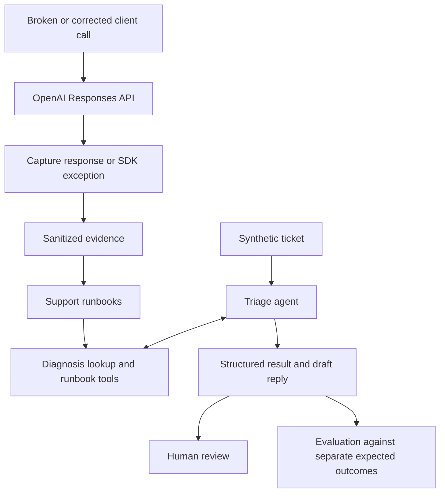

# API Support Lab

A Python learning lab for reproducing API failures, developing support runbooks, and evaluating agent-assisted ticket triage.

**Status: slice 4 complete, with 4 of 4 reproduction cases live-verified.** All four cases have a reviewed broken/fixed pair and a support-facing runbook. The three new pairs were observed on 2026-10-22 in six authorized requests, with zero retries, reruns, or limit adjustments. Deterministic tools, one asynchronous draft-only agent, single-ticket triage, and offline saved-result scoring remain available. The earlier T-001/T-005/T-009 live pilot passed automated checks, Codex-assisted qualitative reply review, artifact review, and offline rescoring. This is a small demonstration; human approval is still required before using a reply. Seven remaining tickets and the walkthrough remain planned. The expanded runbooks, schema diagnosis mapping, and revised instructions have not had another live agent evaluation.

## Learning goals

- Reproduce common failures against the OpenAI API and collect useful diagnostic evidence.
- Distinguish similar symptoms without assuming that an HTTP status identifies the cause.
- Write runbooks with practical fixes, clear customer replies, and escalation checklists.
- Explore function tools and structured agent outputs, including when to ask for more information.
- Evaluate drafts against synthetic tickets and make limitations visible.

## Intended workflow



Live reproductions use the real API. The client mistake and customer tickets are synthetic. Saved evidence supports offline checks; the triage agent reads runbooks and drafts replies for a person to review. Model behavior has offline SDK checks and one live three-ticket pilot; these do not establish general reliability.

## Initial cases

| Case | Intended experiment | Corrected behavior |
| --- | --- | --- |
| Invalid credentials | Make a request with an intentionally invalid credential | Repeat the request using a valid environment-provided credential |
| Malformed tool schema | Send an invalid function-tool schema | Send a supported schema for the same task |
| Incomplete structured output | Restrict the output budget until the response is incomplete | Use a sufficient bounded budget and verify completion and parsed output |
| Client timeout | Set an impractically short client timeout | Use a suitable timeout for the same bounded request |

Reviewed observations are linked from the [authentication](runbooks/invalid_credentials.md), [tool schema](runbooks/tool_schema.md), [incomplete output](runbooks/incomplete_output.md), and [client timeout](runbooks/timeout.md) runbooks. Each case has one reviewed live pair; these examples do not establish general reliability or diagnose a customer's request. Offline fixtures remain authored examples, never API observations. The invalid-credential experiment does not establish that a particular key was revoked.

The first release also targets one agent, three read-only tools, and ten synthetic evaluation tickets. Context overflow, model-access failure cases, rate limits, and quota exhaustion are deferred.

## Illustrative example

This example describes intended behavior; it is not a captured API response or an executed agent result.

**Ticket:** “The API returns HTTP 200, but our JSON parser sometimes fails. The nightly report is blocked.”

**Expected approach:** retrieve the incomplete-output runbook, retain output exhaustion as a hypothesis, and ask for the response completion status, incomplete reason, configured output limit, and a sanitized failing excerpt. Other causes remain possible.

**Draft reply:** “Could you share the response status and incomplete details, the configured output limit, and a small sanitized example that fails to parse? That will help distinguish an incomplete response from a parsing issue.”

The result should use `request_info` and mark the diagnosis as inferred. HTTP success alone does not establish that the requested task completed.

## Setup and current usage

Use Python 3.14 and [uv](https://docs.astral.sh/uv/getting-started/installation/),
installed and available on your `PATH`. Install the locked dependencies from the checkout:

```sh
uv sync --locked
uv run --offline --locked --no-env-file python -m api_support_lab --help
env -u OPENAI_API_KEY uv run --offline --locked --no-env-file pytest
uv run --offline --locked --no-env-file python -m api_support_lab diagnose --status 401 --error-code invalid_api_key
```

Setup may download dependencies; the help command and default tests need neither network access nor credentials after setup.

The CLI implements `reproduce CASE --variant broken|fixed --live` for all four case IDs. Each invocation makes one request with retries disabled and `store=False`. Only broken authentication avoids loading the environment key; all other variants require `OPENAI_API_KEY` after live opt-in. Authentication's reviewed pair was observed on 2026-10-21 in America/New_York (2026-10-22 UTC); the other three pairs were observed on 2026-10-22 in both time zones. Future live execution remains separately authorized, explicitly opted-in work.

Help and valid offline diagnosis return exit code 0, including an empty candidate list for unknown codes. Reproduction exit code 0 means that single attempt matched its expected behavior; other outcomes remain saved and return 1. Neither one passing attempt nor HTTP 200 alone verifies a pair. Configuration/argument errors and missing live opt-in return 2.

| Case | Broken-attempt check | Corrected-attempt check |
| --- | --- | --- |
| `invalid_credentials` | HTTP 401 and SDK `AuthenticationError` | HTTP success, completed status, nonempty text |
| `tool_schema` | HTTP 400, SDK `BadRequestError`, parameter identifying `tools` | HTTP success, completed status, nonempty text |
| `incomplete_output` | HTTP success, `incomplete`, reason `max_output_tokens` | Completed HTTP success plus strict schema and expected-content validation of the full JSON |
| `timeout` | SDK `APITimeoutError` captured as `client_timeout` | HTTP success, completed status, nonempty text |

The schema predicate is conservative: the live rejection supplied `invalid_function_parameters` at `tools[0].parameters`, but the attempt check does not require an exact code/message. New corrected checks also reject response errors and incomplete details. No visible JSON is required for budget exhaustion, although the observed broken response emitted partial JSON. A timeout without a response retains null HTTP fields and request ID; it does not prove that server processing stopped. `output_valid` is a boolean only when structured-output validation applies, otherwise null. It is computed before saving a sanitized excerpt capped at 1,000 characters.

The new broken defaults are 128 output tokens for incomplete output and a 0.5-second client timeout for timeout. Other defaults remain 2,048 tokens and 60 seconds. `--max-output-tokens N` and `--timeout-seconds N` override the effective limits for either variant, and the artifact records them. Both variants use the same workload/schema except for the intended defect or limit. Do not loop automatically to find a trigger; future live investigation is limited to the documented 30-minute timebox, spending review, and explicit authorization. The [maintainer reproduction guide](docs/reproduction-guide.md) contains the experiment procedures and command forms; offline CLI checks do not imply live verification.

## Triage and the three-ticket pilot

The ordinary `diagnose`, `list_runbooks`, and `get_runbook` functions operate offline. The registry exposes all four verified runbooks. Reviewed errors support the authentication 401/`invalid_api_key` and schema 400/`invalid_function_parameters` mappings. Incomplete output and client timeout use symptom-based discovery/retrieval; no HTTP-success or timeout-status mapping is invented. A status-only candidate remains a hypothesis; an unfamiliar code does not match. Registered IDs restrict access, and resources resolve from the checkout rather than the caller's working directory. Run this lab from an installed checkout; standalone wheel resource packaging is outside this slice.

Runbooks serve support staff and the triage agent investigating customer symptoms. They cover evidence to request, diagnosis, corrective steps, customer recovery checks, and escalation, with brief confidence notes and evidence links. The customer's affected workflow determines recovery. Synthetic lab execution, pair verification, and evidence-publication procedures belong in the separate maintainer guide, which the runbook tools do not expose. The earlier pilot's saved retrievals remain unchanged; revised runbook text has no new live evaluation.

The initial tickets use their final planned IDs: [T-001](triage/tickets/T-001.yaml) (clear authentication evidence), [T-005](triage/tickets/T-005.yaml) (partial complaint), and [T-009](triage/tickets/T-009.yaml) (SSO setup outside coverage). Only subject, body, and pasted error reach the agent. Provenance and [expected outcomes](triage/expected.yaml) stay outside its input. The evaluator loads expectations after execution.

These live command forms are implemented and exercised against an in-memory transport with dummy credentials. The evaluation command also completed one separately authorized live pass on 2026-10-22; the single-ticket CLI form has only offline checks. Another live pass requires new authorization:

```sh
uv run --locked --env-file .env python -m api_support_lab triage triage/tickets/T-001.yaml --live
uv run --locked --env-file .env python -m api_support_lab evaluate --live
```

Triage prints a draft for human review and saves a separate sanitized JSON run under `artifacts/triage/`. Evaluation runs the three tickets sequentially, saves each run under `artifacts/evaluation/runs/`, and writes a unique report under `artifacts/evaluation/`. Both accept `--output-dir PATH`. No command sends the reply or changes an account. Each run uses Responses, low reasoning, a 4,096-token cap per response, eight turns, an explicit 60-second client timeout, zero client/runner retries, `store=False`, and disabled remote tracing. These are request bounds, not a billing ceiling or whole-run deadline.

Before accepting a draft, the workflow validates structured output, successful retrieval for every referenced case ID, and lookup arguments against explicit ticket fields. Observed evidence must be short verbatim ticket extracts. The conservative field recognizer accepts `HTTP NNN`, `status: NNN` / `http_status: NNN`, and `code: value` / `error_code: value`, including quoted JSON fields; other prose should prompt clarification. Tool errors, API errors, timeouts, refusals, incomplete/invalid outputs, unsupported retrieval, and turn exhaustion save failed runs with no accepted draft. Logs retain sanitized tool arguments/results and available per-response usage. Failure records retain exception types, without raw exception messages or response/prompt dumps. Missing usage means unknown cost.

Score existing artifacts without credentials or model calls:

```sh
env -u OPENAI_API_KEY uv run --offline --locked --no-env-file python -m api_support_lab evaluate --results PATH
```

`PATH` may be a single run, an evaluation report containing `runs`, or a directory of individual run JSON files. Scoring uses the current three tickets and separate expectations. Missing/duplicate tickets, invalid results, failed retrieval, invented lookup arguments, mismatches, and ticket hash changes remain visible. Unknown or corrupt directory entries create report input issues. Scoring one ticket still uses a denominator of three; the two absent tickets fail. A report preserves model/settings/SDK versions and usage inside its run records. Offline scoring creates no client and does not load live settings or credentials.

Triage returns 0 for an accepted draft and 1 for a failed run. Evaluation returns 0 only when all three automated outcomes agree and there are no input issues; otherwise it returns 1. This is automated agreement, not reply approval. Each report has `manual_reviews` keyed by ticket ID, initially `{"status": "pending", "notes": ""}`. Review each actual reply for useful questions, supported fixes, uncertainty, sensitive-data requests, and routing language; record `pass` or `fail` with notes. Rescoring a report preserves those reviews. Schema and retrieval checks cannot prove prose correctness.

Configuration defaults to `gpt-6.1-sol`, Responses, low reasoning, a 60-second request timeout, and no automatic retries. Authentication requests use a 2,048-token output cap and disable response storage with `store=False`; agent responses use a 4,096-token cap and eight turns. `API_SUPPORT_LAB_MODEL` overrides the model. Credentials are loaded separately from `OPENAI_API_KEY` only when constructing an explicitly authorized live client that needs the environment credential; they are never stored in the settings object. The Agents SDK setup helper explicitly disables remote tracing. Importing the package or invoking CLI help creates no SDK client.

The application does not automatically load `.env`. Use `uv run --env-file .env` explicitly for a later authorized fixed request; `.env` is ignored by version control. Default tests need no credentials. `--no-env-file` prevents uv from loading an environment file for offline checks; uv's `--offline` controls dependency downloads and does not block an application's own network requests. The pytest network tripwire supplies that test boundary.

Capture stores only allowlisted diagnostic fields, bounded text output, selected usage counts, and effective request settings. It redacts the active credential plus recognizable key/bearer strings before truncating output or writing JSON. When a server error body exists, capture selects only its structured message field; a missing message stays null rather than falling back to a dump of the body. Missing HTTP fields stay null; refusals are distinct from completed text and incomplete responses. Programming mistakes propagate instead of being recorded as API failures.

Each attempt gets a separate timestamped, uniquely named JSON file under the checkout's ignored `artifacts/evidence/`. Optional `--output-dir PATH` overrides the directory. A failed expectation does not remove its artifact. Filesystem failures do not trigger another request. Review sanitization before deliberately selecting any observation for the public tree; redaction is not a guarantee that arbitrary sensitive content will be recognized.

Tests block DNS resolution and outbound socket connections inside offline test execution. Tests marked `live` are skipped unless `--run-live` is supplied; selecting the marker alone does not enable them. The current suite has no live API tests. Its opt-in checks use a harmless generated test; authentication tests use dummy credentials and an in-memory transport, including real SDK request serialization, parsing, and exception handling. All test artifacts stay in temporary directories and are never public evidence. The network tripwire is a pytest fixture, not a production guard framework or an OS network sandbox.

The environment and local interfaces were checked on Python 3.14.4 with uv 0.13.5, OpenAI SDK 3.36.0, Agents SDK 0.24.0, Pydantic 2.14.1, PyYAML 6.0.3, and pytest 9.1.1. Exact runtime and test dependencies are in `uv.lock`. Slice 4 has **222 passing offline tests** after the live-evidence mapping update; its initial offline phase had 219, and slice 3 had 148. These include strict function-tool schemas, the asynchronous SDK loop through an in-memory transport, pilot outcomes, saved-result scoring, and observation-backed/unknown diagnosis checks. Authored fixtures remain separate from live observations.

Slice 4's initial implementation and runbook-audience refactor made no API calls or real-credential/`.env` reads. A subsequent authorized live checkpoint loaded the project-root `.env` without displaying credentials and made exactly six requests. Schema rejection/correction, budget exhaustion/correction, and client timeout/correction all matched their intended outcomes; captures passed exact-credential, recognizable-pattern, structural, and qualitative review. Reviewed copies are linked from the runbooks; originals and the local audit remain under ignored `artifacts/evidence/slice4-live-20261022/`. Available usage totals 331 input and 475 output tokens (806 total) across four responses, with no cached or reasoning tokens reported. At documented standard rates this estimates to $0.005412 for the known usage only, not a billed-charge confirmation. Rejected-request and timeout usage/cost remain unknown; service tier and account billing were not inspected. The [maintainer guide](docs/reproduction-guide.md#reviewed-slice-4-observations) records the results and limits. No additional triage evaluation ran; the ten-ticket expansion remains slice 5.

Slice 2's live checkpoint is complete: one broken and one corrected request, both with zero retries; reviewed evidence is linked from the authentication runbook. The correction reported 13 input and 5 output tokens. Its standard-rate token estimate is $0.000076, not a confirmed billing charge; rejected-request usage and the remaining account balance are unknown.

Slice 3's implementation phase accessed no real key or `.env` contents and made no API calls. The subsequent explicitly authorized live pilot loaded the project-root `.env` without displaying credentials and ran evaluation exactly once. It produced six recorded model responses across the three tickets (3/2/1 respectively), with 7,863 input tokens, 814 output tokens, and 8,677 total tokens reported; 1,064 input tokens were cached and 59 output tokens were reasoning tokens. The settings matched the requested bounds: `gpt-6.1-sol`, low reasoning, eight turns per ticket, 4,096 output tokens per response, a 60-second client timeout, zero retries, disabled tracing, and `store=False`. There were no recorded failures or semantic mismatches, and saved results passed offline rescoring. Exact-match/pattern and qualitative artifact review found no exposed credential, unexpected sensitive fields, or prompt/environment dumps. Codex-assisted reply review found all three intended actions supported; T-001's draft could be shortened before customer use. The [selected reviewed report and pilot summary](evidence/triage/README.md) are included as public learning-lab evidence. Original runs, the reviewed report, and its offline score remain unchanged under the ignored local `artifacts/evaluation/live-pilot-20261022/`. No reply was sent and no account settings were changed. No rerun occurred. Billed charges and account spending were not inspected; review them before more live work. This pilot does not complete the ten-ticket release evaluation.

The initial experiment budget is $15, with a target of 8–12 build hours. These are planning limits, not a cost estimate or an automatic billing guarantee. Live calls and agent runs may incur charges.

## Project documentation

- [Requirements](docs/requirements.md): capabilities, constraints, scope, and acceptance criteria.
- [Architecture](docs/architecture.md): components, interfaces, data handling, and design tradeoffs.
- [Implementation plan](docs/implementation-plan.md): build order, verification checkpoints, and cut lines.
- [Maintainer reproduction guide](docs/reproduction-guide.md): synthetic experiments, CLI commands, attempt checks, and evidence/pair review; support troubleshooting remains in the runbooks.

All customer organizations and tickets will be invented. Evidence will be sanitized, and results will be presented as a small learning demonstration rather than a reliability benchmark. A future walkthrough will show a supported diagnosis, a request for missing evidence, and an escalation.

This project is being developed with Codex as a pair-programming assistant.
