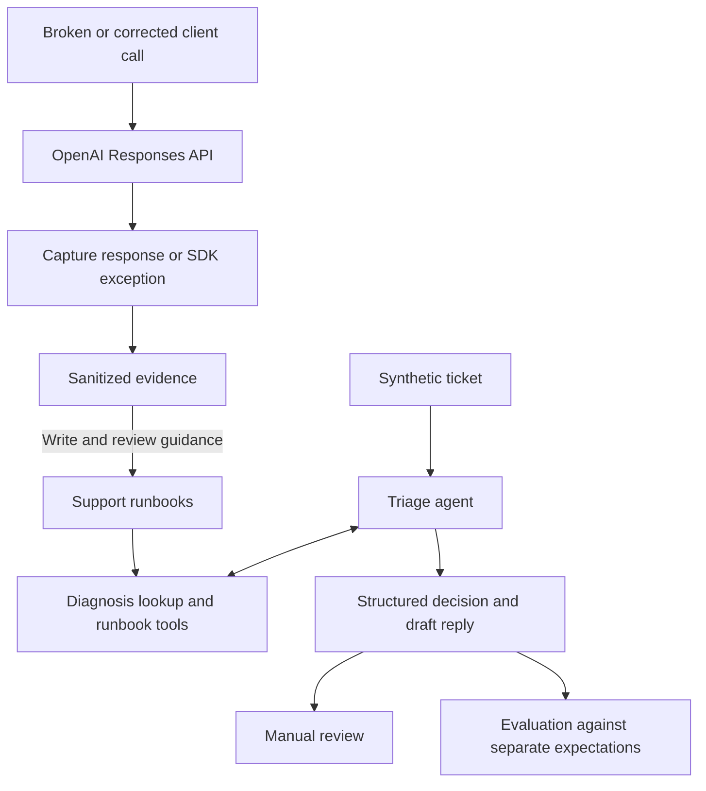

# API Support Lab

A small personal project that reproduces four OpenAI API failures against the live API, writes a support runbook for each from the captured evidence, and runs a triage agent that uses those runbooks to draft replies to 13 synthetic support tickets. The agent drafts; I review every reply before treating it as something I would send.

Built on the OpenAI Responses API and the Agents SDK, with Codex as the pair. Everything saved here ran against `gpt-6.1-sol` (`openai` 3.36.0, `openai-agents` 0.24.0).

## A saved example

A synthetic ticket reports: “The API returned HTTP 200 but our JSON parser failed on the response.” The nightly report is blocked, and completion details and failing output were not retained.

The agent listed the runbooks, retrieved the incomplete-output one, and returned this decision (full record: [T-006.json](evidence/triage/runs/T-006.json)):

```json
{
  "category": "incomplete_output",
  "basis": "inferred",
  "severity": "high",
  "action": "request_info",
  "missing": [
    "On the next failing run, capture completion status, incomplete_details, any refusal or response error, and request ID if received before parsing.",
    "Model, SDK version, configured max_output_tokens, and reasoning setting.",
    "Expected JSON schema and minimal sanitized extraction/parsing code identifying the selected response field; on the next failure, a short sanitized output excerpt with any excerpt truncation noted.",
    "When failures started, whether all or some requests fail, relevant input-size or dataset changes, and UTC times for the next failing and last successful run if available."
  ]
}
```

Its saved reply begins:

> Thanks for sharing the parser error and explaining that your nightly report is blocked. HTTP 200 shows that a response arrived, but the parser error alone cannot distinguish incomplete generation from an extraction or JSON-format issue; it does not establish that the output limit was reached.

The category is a hypothesis; the severity comes from the blocked report; the next step is to collect completion details and a sanitized failing excerpt.

This excerpt comes from the [published T-006 run](evidence/triage/runs/T-006.json) in the batch I reviewed on 2026-10-27. I selected **Send with edits**, removing one redundant sentence later in the reply. I saved the [edited wording](evidence/triage/edited-replies/T-006.md) separately. The [walkthrough](docs/walkthrough.md) follows this example alongside a supported correction, an escalation, and a misleading customer diagnosis.

## What is implemented

| Case | Synthetic reproduction setup | Observed result (live, 2026-10-22 UTC) | Runbook |
| --- | --- | --- | --- |
| Invalid credentials | Deliberately invalid API key | HTTP 401 `AuthenticationError`, code `invalid_api_key` | [invalid_credentials](runbooks/invalid_credentials.md) |
| Malformed tool schema | `"type": "not_a_json_schema_type"` in a strict function tool | HTTP 400 `BadRequestError`, code `invalid_function_parameters`, param `tools[0].parameters` | [tool_schema](runbooks/tool_schema.md) |
| Incomplete structured output | `max_output_tokens: 128` for a 32-item JSON-schema workload | HTTP 200 with `response_status: incomplete`, `incomplete_reason: max_output_tokens` | [incomplete_output](runbooks/incomplete_output.md) |
| Client timeout | 0.5-second client timeout, zero retries | `APITimeoutError` after about 620 ms; no HTTP status, request ID, or usage | [timeout](runbooks/timeout.md) |

Two of the four come back with an error code to look up (401 and 400). The other two do not: an HTTP 200 whose output is incomplete, and a client timeout that never receives a response. Those are the tickets where the status code alone does not tell you what went wrong, and they are why the agent has a `list_runbooks` tool and a `basis` field.

For ticket triage, one agent with three read-only tools returns a structured decision and a draft reply for each of the [13 tickets](triage/tickets/); five paste diagnostics from the live captures. All 13 saved [runs](evidence/triage/runs/) are in the repo, one file per ticket, with my [manual review](evidence/triage/manual-review.md) and the three edited replies I approved.

I kept the failure set to four on purpose, to leave time to build and test the triage agent properly. Rate limits, quota, model access, and context overflow are out of scope, as are MCP, hosting, and external ticketing.

The shared tools are ordinary Python functions: `diagnose`, `list_runbooks`, and `get_runbook`. The status/code mappings come from the captured errors. The case IDs are part of the tool and output schemas, so the agent can go straight to a runbook when a name matches the symptom; `list_runbooks` is for when none does. Unknown codes remain unmatched, and symptom-based retrieval supports cases without a diagnostic status/code mapping.

## Quick start

Needs Python 3.14 and [uv](https://docs.astral.sh/uv/getting-started/installation/) on your `PATH`; uv can fetch Python if needed. Run these commands from a checkout:

```sh
uv sync --locked
uv run python -m api_support_lab diagnose --status 401 --error-code invalid_api_key
uv run pytest -q
uv run python -m api_support_lab evaluate --results evidence/triage/runs
```

None of these need an API key. `diagnose` prints `["invalid_credentials"]`: a candidate, not a verdict. The tests run the agent loop against an in-memory transport with dummy credentials, and a pytest guard fails any test that tries to reach the network. `evaluate --results` scores the saved runs against `triage/expected.yaml` without calling the model and prints 13/13; it does not rerun the agent. Generated files go under the ignored `artifacts/` directory.

For a live draft, copy `.env.example` to `.env`, configure your own project key, and explicitly load it:

```sh
uv run --locked --env-file .env python -m api_support_lab triage triage/tickets/T-006.yaml --live
```

The application does not automatically load `.env`; it is ignored by Git. Live commands require `--live` and may incur charges. The agent reads runbooks and drafts replies; it cannot send messages, run reproductions, or change accounts. Review every draft before use.

## How it works



Capture keeps the diagnostic fields, effective settings, a bounded output excerpt, and usage. Code checks the shape of the result, that any runbook the agent cites was actually retrieved, and that lookup arguments came from the ticket. Whether the reply is right, and whether it asks for the right things, is still a person's call; that is what the [manual review](docs/manual-review.md) is for.

Three rules shape the agent:

- It passes only ticket-stated status/code values to `diagnose`. For [T-005](triage/tickets/T-005.yaml), the customer's authentication suspicion supplies neither; the saved agent run lists runbooks, retrieves credential guidance, and asks for diagnostics instead of guessing a lookup code. `category`, `basis`, `severity`, and `action` are schema-restricted, so the agent cannot invent a case name either.
- It must retrieve supporting guidance before recommending a case-specific fix. A result referencing a runbook it never retrieved is rejected.
- `basis` records whether supplied diagnostics directly support the category (`stated`), symptoms support a hypothesis (`inferred`), or no supported category is determined (`none`). For [T-008](triage/tickets/T-008.yaml), pasted schema diagnostics take precedence over the customer's authentication claim.

## Results and limits

Each case has one reviewed live broken/corrected pair: a reproduction, not a benchmark.

I ran all 13 tickets once each, sequentially, with no retries. All 13 passed the automated checks (category, basis, action, severity, retrieval, verbatim evidence, ticket hash). Separately, I read every draft: 10 I would send as-is, 3 with edits, 0 I would not send. The [manual review](evidence/triage/manual-review.md) has the per-ticket verdicts; the [edited replies](evidence/triage/edited-replies/) hold the wording I approved, kept apart from the generated text. There is no separate holdout set, so this shows the loop working on these 13 tickets, not how the agent would do on unseen ones.

The offline tests (279, mostly parametrised) cover capture, redaction, tool schemas, the agent loop against an in-memory transport, and scoring. They test the software, not the quality of a live reply. All organizations and tickets are invented.

## Explore further

- [Walkthrough](docs/walkthrough.md): four saved decisions, actual replies, and a code-reading path.
- [Manual review](docs/manual-review.md): assessing actual questions, with a model grader left as future work.
- [Development notes](docs/development-notes.md): project attribution, the design calls, and how the agent was tuned.
- [Architecture](docs/architecture.md): components, interfaces, and design tradeoffs.
- [Reproduction guide](docs/reproduction-guide.md): running the cases and publishing evidence.
