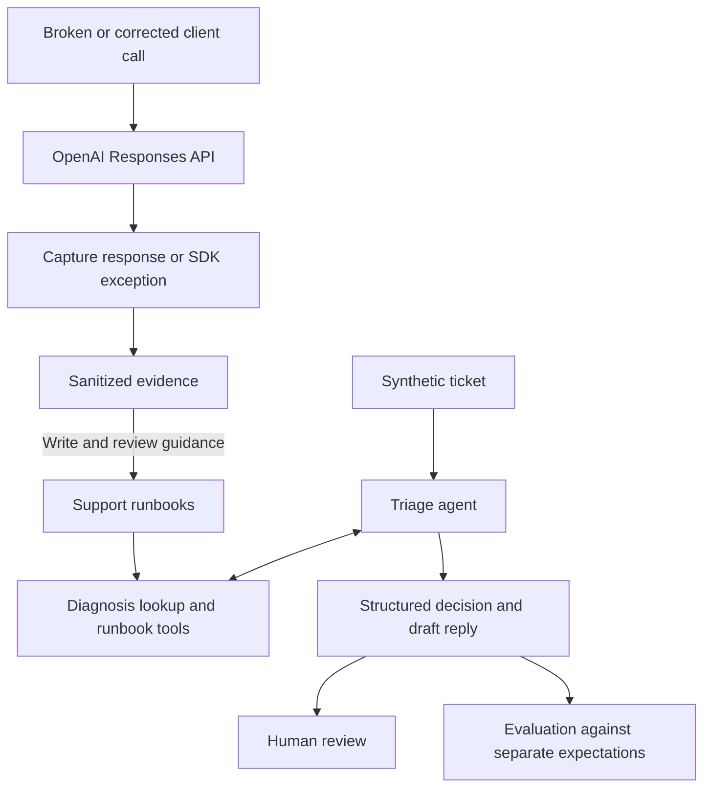

# API Support Lab

A personal Python learning lab for reproducing OpenAI API failures, capturing diagnostic evidence, and using an agent to draft support replies for human review.

The project connects a small failure lab to a support workflow: investigate a symptom, retrieve relevant guidance, distinguish evidence from assumptions, and suggest the next useful step. It explores Python automation with the OpenAI Responses API and Agents SDK, developed with Codex as a pair-programming assistant.

## A saved example

A synthetic ticket reports: “The API returned HTTP 200, but our JSON parser failed.” The nightly report is blocked, and completion details have not been saved.

The agent retrieved the incomplete-output runbook and returned these fields:

```json
{
  "category": "incomplete_output",
  "basis": "inferred",
  "severity": "high",
  "action": "request_info"
}
```

Its saved reply begins:

> HTTP 200 confirms a response arrived, but not that its output was complete. The parser error alone does not establish token-budget exhaustion; extraction or parsing problems are also possible.

The category is a hypothesis. The blocked report supports high severity; the parser error does not establish the cause. The next step is collecting completion details and a sanitized failing excerpt.

This is an excerpt from [T-006](triage/tickets/T-006.yaml) in the [saved live evaluation](evidence/triage/ten-ticket-follow-up-20261022/reviewed-evaluation.json), not a newly generated response. The [walkthrough](docs/walkthrough.md) follows this example alongside a supported correction and an escalation.

## What is implemented

| Capability | Experiment or behavior | Evidence |
| --- | --- | --- |
| Invalid credentials | Compare an intentionally invalid credential with a valid environment-provided credential | [Runbook and live pair](runbooks/invalid_credentials.md) |
| Malformed tool schema | Compare an invalid function parameter type with a supported schema | [Runbook and live pair](runbooks/tool_schema.md) |
| Incomplete structured output | Compare a restrictive output budget with a sufficient bounded budget; validate full corrected output | [Runbook and live pair](runbooks/incomplete_output.md) |
| Client timeout | Compare a very short client timeout with a suitable bounded timeout | [Runbook and live pair](runbooks/timeout.md) |
| Ticket triage | One agent uses three read-only tools and returns a structured decision plus a draft reply | [Ten-ticket evaluation](evidence/triage/ten-ticket-follow-up-20261022/README.md) |

The shared tools are ordinary Python functions: `diagnose`, `list_runbooks`, and `get_runbook`. Exact diagnostic matches come from reviewed observations. Unknown codes remain unmatched, and symptom-based retrieval supports cases without a diagnostic status/code mapping.

## Quick start

Use Python 3.14 and [uv](https://docs.astral.sh/uv/getting-started/installation/) on your `PATH`. Run these commands from a checkout:

```sh
uv sync --locked
uv run --offline --locked --no-env-file python -m api_support_lab --help
```

Setup may download Python or dependencies. After setup, help, diagnostic lookup, saved-result scoring, and the default tests need no API key or model calls:

```sh
uv run --offline --locked --no-env-file python -m api_support_lab diagnose \
  --status 401 --error-code invalid_api_key
env -u OPENAI_API_KEY uv run --offline --locked --no-env-file pytest -q
```

The diagnosis command prints `["invalid_credentials"]`, a candidate for investigation. Tests use dummy credentials and an in-memory transport; a pytest DNS/socket guard blocks unexpected network access during offline test execution. `uv --offline` itself only controls dependency downloads.

Rescore the checked-in final report:

```sh
env -u OPENAI_API_KEY uv run --offline --locked --no-env-file python -m api_support_lab evaluate \
  --results evidence/triage/ten-ticket-follow-up-20261022/reviewed-evaluation.json \
  --output-dir artifacts/evaluation/offline-scores
```

This writes a new local report and prints **10/10 automated agreement**, with zero operational failures and zero semantic mismatches. It checks the saved outputs against current expectations without rerunning the agent or approving the replies. Generated artifacts stay under ignored `artifacts/`; selected public evidence lives under `evidence/`.

For a live draft, copy `.env.example` to `.env`, configure your own project key, and explicitly load it:

```sh
uv run --locked --env-file .env python -m api_support_lab triage triage/tickets/T-006.yaml --live
```

The application does not automatically load `.env`; it is ignored by Git. Live commands require `--live` and may incur charges. The agent reads runbooks and drafts replies; it cannot send messages, run reproductions, or change accounts. Review every draft before use.

## How it works



Evidence capture retains selected diagnostics, effective settings, bounded output, and available usage. Runtime validation checks structured output, supporting retrieval, and ticket-grounded lookup arguments. The model interprets symptoms and drafts prose; those checks cannot establish that every sentence is correct or useful.

## Results and limits

Each of the four reproduction cases has one reviewed live broken/corrected pair. The final ten-ticket pass reached 10/10 automated agreement after tuning on those same synthetic tickets; it is not a held-out reliability result. The original baseline and failed outcomes remain preserved. The [evaluation record](docs/evaluation-follow-up.md) separates agent improvements from a scorer revision; the final outputs score 9/10 under the original rubric.

The suite has **281 offline tests**. These verify software behavior, not general agent performance. All organizations and tickets are invented; live captures concern synthetic API workloads. Redaction needs review before sharing. Rate limits, quota exhaustion, model-access failures, external ticketing integrations, and broader evaluations remain outside the implemented coverage.

## Explore further

- [Walkthrough](docs/walkthrough.md): three saved decisions, actual replies, and a code-reading path.
- [Development notes](docs/development-notes.md): working with Codex, design corrections, and evaluation lessons.
- [Architecture](docs/architecture.md): components, interfaces, and design tradeoffs.
- [Reproduction guide](docs/reproduction-guide.md) and [evaluation guide](docs/evaluation-guide.md): operating the lab and inspecting results.
- [Requirements](docs/requirements.md): the learning project's capability and acceptance criteria.
