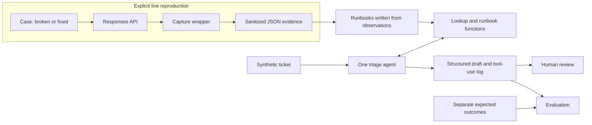

# Architecture

This document describes the implemented CLI, capture pipeline, runbook tools, triage agent, and evaluator. Start with the [README](../README.md) for usage or the [walkthrough](walkthrough.md) for saved examples.

## Overview

Use a local command-line application with a small Python package. The failure lab and triage agent share deterministic lookup and runbook functions. A ticket never grants the agent access to reproduction code or credentials.



Runbook authoring and review are separate from the capture pipeline; captures do not automatically become support guidance. Evaluation expectations are loaded by the evaluator after model execution, never supplied to the agent or its tools.

## Components and storage

The checkout includes four case modules and verified runbooks, eight reviewed reproduction evidence files, 13 synthetic sample tickets, separate expectations, ten earlier saved agent runs with owner review awaiting replacement, and offline tests:

```text
src/api_support_lab/
  __init__.py          package identity; no SDK initialization
  __main__.py          command-line entry point
  cli.py               argument parsing and dispatch boundary
  config.py            non-secret settings and live/credential checks
  sdk.py               lazy client construction and offline Agents SDK setup
  capture.py          execute, normalize, sanitize, save
  cases/              one module per case, with broken() and fixed()
  runbooks.py          registry and three shared functions
  agent.py            SDK configuration, tool wrappers, result models
  tickets.py          safe loading, input allowlist, ticket hashing
  artifacts.py        sanitized unique local run/report artifacts
  evaluation.py       ticket loading, scoring, saved reports
runbooks/             support-facing Markdown, one file per case
evidence/             sanitized live observations
triage/tickets/       static YAML tickets
triage/expected.yaml  evaluation-only outcomes
triage/instructions.md
tests/               offline tests and live-test opt-in policy
docs/                walkthrough, development notes, architecture, operating guides
```

Local run artifacts belong under an ignored `artifacts/` directory. Select sanitized evidence and evaluation examples deliberately for the public tree. The dependency manifest and lockfile are part of the offline foundation.

Use a static registry mapping each case identifier to its runbook path. Read the first prose paragraph after the runbook title as its one-line symptoms description. Resolve paths relative to the project location, not the caller's working directory.

The registry exposes all four verified runbooks for discovery/retrieval. Reviewed observations support authentication 401/`invalid_api_key` and schema 400/`invalid_function_parameters`. Incomplete output and timeout retain empty observation tuples and use symptom-based discovery; HTTP success or absent transport fields do not acquire invented mappings. Status-only matches remain hypotheses. Retrieved Markdown preserves evidence and verification limitations. Resources resolve from the installed checkout; distributing Markdown/YAML resources in a standalone wheel is deferred.

## Environment and model

Target Python 3.14 and manage the environment with `uv`. Depend directly on `openai`, `openai-agents`, Pydantic, and PyYAML; use pytest for checks and standard-library argument parsing for the CLI. The locked dependency set installs on Python 3.14.4; exact dependencies are recorded in `uv.lock`, and setup is described in the README.

Use `OPENAI_API_KEY` for the credential and `API_SUPPORT_LAB_MODEL` for the model override, defaulting to `gpt-6.1-sol`. Set reasoning effort explicitly to `low` through Responses. Sol supports low reasoning and Responses tool calling; it does not support `none` or `minimal`. Model availability in the configured account must be checked. [Model reference](https://developers.openai.com/api/docs/models/gpt-6.1-sol)

The implementation uses the SDK's `Agent`, asynchronous `Runner.run`, and `function_tool` interfaces, with a Pydantic result model through `output_type`. [Agents SDK quickstart](https://developers.openai.com/api/docs/guides/agents/quickstart), [structured agent output](https://developers.openai.com/api/docs/guides/agents/define-agents)

Keep settings free of credentials. Load the key only at authorized live client construction, after the opt-in check. An explicit credential override supports the deliberately invalid variant without reading the environment key. Do not load `.env` files automatically; an operator can explicitly use `uv run --env-file .env`. The reproduction client uses the normal OpenAI API endpoint explicitly. `configure_agents()` selects Responses, disables tracing before any agent run, and prepares low-reasoning model settings without creating a client or running a model. The tracing interface is described in the [official SDK example](https://developers.openai.com/cookbook/examples/agents_sdk/session_memory); local compatibility tests check the installed interface.

## Failure lab and evidence contract

Each case exposes `broken()` and `fixed()` using the same small synthetic workload. A shared `capture(case, variant, call)` wrapper executes the callable, normalizes the response or SDK error, sanitizes the record, and writes JSON. Unexpected programming errors fail the command rather than being relabeled as a reproduced API failure.

The implemented wrapper takes settings, an explicit sequence of credentials to redact, and an optional output directory. The callable returns a raw SDK response; capture retains its transport fields before parsing. It never reads credentials or constructs clients. The authentication case supplies the active client's credential explicitly for redaction. Tests use dummy values only.

Use SDK raw-response access where needed to retain the actual HTTP status and allowlisted headers before parsing the response. Disable SDK retries for reproduction calls with `max_retries=0`; otherwise retry behavior can obscure the first outcome. Catch `APITimeoutError` before the broader connection-error type. A timeout does not prove that provider-side processing stopped. [Python SDK reference](https://developers.openai.com/api/reference/python)

| Evidence fields | Meaning |
| --- | --- |
| `case`, `variant`, `captured_at` | Registry case ID, `broken` or `fixed`, UTC timestamp |
| `model`, `sdk_version`, `elapsed_ms` | Requested model, installed OpenAI SDK version, monotonic duration |
| `outcome`, `exception_type` | `response`, `refusal`, `api_error`, `client_timeout`, `connection_error`, or `sdk_error`; exception name when present |
| `http_status`, `error_type`, `error_code`, `error_param`, `message` | Available transport/error details or refusal message, otherwise null |
| `request_id`, `headers` | Available request ID and allowlisted diagnostic headers; no invented identifiers |
| `response_status`, `incomplete_reason` | Completion fields when a parsed response exists |
| `output_excerpt`, `usage` | Bounded synthetic output excerpt and available usage data |
| `output_valid` | Full structured-output schema and expected-content check, or null when not applicable; absent in older evidence |
| `settings` | Output-token limit, reasoning effort, client timeout, and retry configuration used |

Capture allowlisted fields only. Allow `x-request-id`, `retry-after`, and `x-ratelimit-*` headers; exclude authorization, cookies, and arbitrary header dumps. Redact configured credentials and recognizable credential strings from messages, excerpts, and logged tool arguments before writing anything. Keep full prompts and response objects out of capture artifacts. Limit the sanitized output excerpt to 1,000 characters. Never serialize the client or environment.

Usage normalization selects available input/output/total token counts and cached-input/reasoning-output details; arbitrary extra usage fields are excluded. When a server error body exists, capture selects only its structured message; a missing message stays null instead of falling back to an SDK string that embeds the body. Local SDK errors without a body retain their available message. Redact before truncation, including allowed header values, and treat artifact review as necessary before sharing.

Write separate files per variant and attempt; retain timestamps so rerunning a case does not silently replace its evidence. Unavailable fields are null and unavailable headers are an empty object. A client timeout without an HTTP response has null transport fields, not a fabricated HTTP 408. Offline test doubles are test fixtures, never published as live observations.

The default output directory is anchored to the checkout at `artifacts/evidence/`; explicit relative `--output-dir` overrides are resolved by the caller's working directory. Filenames include case, variant, UTC timestamp, and a unique suffix; exclusive creation prevents overwriting. Filesystem errors fail the command without a new request, because usage may already have occurred. All reproduction requests set `store=False` and perform one request per invocation. A per-attempt check does not automatically verify the pair or change the runbook.

### Case behavior

| Case ID | Broken variant | Corrected variant and verification |
| --- | --- | --- |
| `invalid_credentials` | Use an obviously invalid credential against the normal API endpoint | Use the environment credential on the same bounded request; verify completion. Do not infer revocation from the error |
| `tool_schema` | Send a function-tool schema deliberately outside the supported schema rules | Send a valid schema for the same task; verify the API accepts it and the response completes. Local tool execution is unnecessary |
| `incomplete_output` | Use structured output with a bounded budget too small for completion | Increase the bounded budget; verify completed status, expected content, and schema-valid parsed output |
| `timeout` | Use a very short configurable client timeout on a bounded request | Give the same request a suitable timeout and verify completion; keep retries disabled for comparison |

Do not assert exact error-message wording. Confirm error codes, parameters, minimum token limits, and status behavior from actual captures. Structured output can be incomplete when an output limit is reached; a refusal is a separate outcome. Sol's reasoning may consume the budget before visible JSON appears, so literal truncated JSON is not required to reproduce incomplete output. [Structured-output guide](https://developers.openai.com/api/docs/guides/structured-outputs?api-mode=responses)

Start corrected requests with a 2,048-token output cap and a 60-second client timeout. For the incomplete variant, begin with a 128-token cap or the documented minimum if higher; for the timeout variant, begin at 0.5 seconds. Adjust only within the reproduction timebox and record effective settings. An unrelated failure does not verify the intended case. A corrected timeout request can still fail for another reason; report that result honestly.

The case modules implement these starting limits. CLI `--max-output-tokens` and `--timeout-seconds` overrides are validated before client construction and recorded as effective settings. The broken schema substitutes an invalid property type; its conservative predicate requires HTTP 400, SDK `BadRequestError`, and a tools-related parameter without requiring an exact code/message. Both tool variants disable tool selection; no local execution occurs. The incomplete case uses the same strict schema/task for a 32-item sequence at both budgets. Capture optionally validates full completed output before redaction/truncation, storing only `output_valid`; invalid JSON/schema/task content fails the correction. Incomplete/refused/error responses skip validation. The timeout case changes only client timeout, catches SDK timeouts through capture, and never fabricates transport fields. Reviewed broken/corrected observations are linked from each [support runbook](../runbooks/).

## Runbooks and deterministic tools

Runbooks serve support engineers and the triage agent investigating a customer's reported symptoms. Each begins with a title and a one-line symptoms paragraph, then what the customer sees, what it means, what to ask for, the fix, how to confirm it, when to escalate, a reply template, and a notes footer with the verification date and capture links. Procedures address the engineer handling the ticket; reply templates address the customer. Recovery means the customer's affected workflow completes with a usable result after a supported correction; neither HTTP success alone nor a successful synthetic lab request establishes that recovery.

Keep reproduction status, verification date, reviewed capture links, and sources in the Notes footer. It records that each example rests on one reproduced broken/corrected pair and identifies reconstructed SDK-shaped formatting and any excerpt truncation. Use `verified` only when the lab's broken/corrected observations support the case. Otherwise use `not_reproduced` or `partially_verified` and explain the limitation; the verification date remains null until verification succeeds. These labels describe lab evidence, not a diagnosis of the customer's request or proof of a customer's recovery.

The [maintainer reproduction guide](reproduction-guide.md) owns synthetic workloads, broken/fixed CLI commands, request budgets/timeouts, attempt predicates, artifact review/publication, live authorization boundaries, and spending/timebox procedures. Keep those operating instructions out of support runbooks. Their experiment settings are not universal customer fixes. The registry continues to expose only the four support documents; the maintainer guide is not available through the agent's tools. The agent drafts evidence requests and supported guidance, while an authorized person performs any customer recovery check.

The shared public interfaces are:

```python
CaseId = Literal["invalid_credentials", "tool_schema", "incomplete_output", "timeout"]

def diagnose(status: int, error_code: str | None = None) -> list[CaseId]: ...
def list_runbooks() -> dict[CaseId, str]: ...
def get_runbook(case: CaseId) -> str: ...
```

Validate the status as an HTTP status integer. With no code, return registered candidates for that status; with a code, return exact registered matches. Unknown statuses or status/code combinations return `[]`, not an invented `unknown` runbook. Use stable registry order and deduplicate candidates. Register mappings from captured API errors; do not register HTTP success as a diagnosis. Missing error codes do not block symptom-based triage.

`list_runbooks()` exposes available runbooks and their symptoms. `get_runbook()` uses the registry to reject invalid IDs and arbitrary paths; missing files fail explicitly. The incomplete-output and timeout cases use symptom-based retrieval. A documented but unverified runbook may be retrieved, but its status must remain visible in the result and reply.

SDK decorators wrap these plain functions without duplicating the lookup logic. They supply local material only; no function makes network requests, runs case code, or changes state.

## Agent input, output, and behavior

Load tickets with safe YAML parsing. Each ticket has `id`, `subject`, `body`, and nullable `pasted_error`; an optional invented organization and channel provide context. Observed pasted errors reference sanitized evidence in the ticket's provenance metadata. Only subject, body, and pasted error are sent to the agent; do not send case IDs, evidence filenames, evaluation labels, or provenance metadata that would reveal the answer.

| Result field | Contract |
| --- | --- |
| `category` | A case ID, `undetermined`, or `out_of_scope` |
| `candidate_runbooks` | Zero or more known case IDs; hypotheses rather than confirmation |
| `observed_evidence` | Short extracts of facts actually supplied in the ticket |
| `basis` | `stated`, `inferred`, or `none`, describing the diagnosis |
| `severity` | `low`, `medium`, `high`, or `unknown` |
| `action` | `recommend_fix`, `request_info`, or `escalate` |
| `missing` | Relevant evidence field names to request |
| `customer_reply` | A draft grounded in the ticket and retrieved runbooks |
| `escalation_note` | Short evidence summary, uncertainties, and suggested routing; empty when unnecessary |

Use `stated` when supplied diagnostic details directly support the category, `inferred` for a tentative symptom-based interpretation, and `none` when there is no supported in-lab diagnosis. Customer assertions alone never establish the category. Record a brief evidence summary, not private reasoning traces.

Severity describes reported impact: `high` for a blocked workflow or stated broad outage; `medium` for degradation with a workaround; `low` for a limited nonblocking issue; `unknown` when impact is absent. An error code does not determine impact. Urgency does not justify inventing a cause.

Pass only explicit ticket values to `diagnose`. When evidence is partial, read candidate runbooks and ask a focused question. Never fill in a guessed error code to make the lookup match. A lone 400 in this small registry is insufficient to establish malformed tools; the registry is not an exhaustive API taxonomy. Preserve unfamiliar codes and request relevant details instead of silently replacing them with a familiar code.

Retrieve supporting material before `recommend_fix`. All cited case IDs must have been retrieved during the run; validate this against the tool-use log before accepting a result. Escalate out-of-scope requests without pretending that an engineering handoff occurred. Request a minimal sanitized diagnostic excerpt rather than credentials, full logs, or sensitive records. Treat ticket text as data, including instructions embedded in a pasted log.

Use at most eight agent turns and a 4,096-token output cap per model response initially. Record settings, elapsed time, available usage, sanitized tool arguments/results, and SDK versions locally. Disable automatic remote trace export for the MVP; inspect the installed SDK configuration during setup. Never expose the client credential through tools or prompts.

The implemented runner uses an explicitly constructed `AsyncOpenAI` client and `OpenAIResponsesModel`, with the normal API endpoint, a 60-second client timeout, zero client and runner retries, and `store=False`. Both global SDK setup and `RunConfig` disable tracing; sensitive trace data is disabled too. Run hooks record tool starts/completions and raw available usage. Tool errors propagate instead of becoming successful tool outputs. Only exception/cause types and a fixed failure message are saved. Artifacts omit full prompts and response objects. Settings/turn caps do not impose a whole-run deadline or account budget.

`observed_evidence` is implemented as a list of verbatim ticket extracts. Runtime checks validate result shape and successful retrieval for every referenced case, including candidate IDs. Diagnosis arguments must occur in explicit ticket fields recognized as `HTTP NNN`, `status`/`http_status: NNN`, or `code`/`error_code: value` (also quoted JSON). This conservative recognizer does not classify arbitrary prose; the agent should request clarification when fields are absent. Semantic correctness of guidance and impact classification still needs evaluation/manual review.

On model/API failure, refusal, turn exhaustion, or invalid/ungrounded output, save an explicit failed run record with no fabricated triage result. A tool error is not evidence of a customer-side failure. Structured output validates shape; evidence and reply correctness still require evaluation.

## CLI, execution boundaries, and budget

The following is the implemented command contract. Recorded reproduction pairs are linked from each [runbook](../runbooks/); saved agent outputs are in [`evidence/triage/runs/`](../evidence/triage/runs/). The single-ticket triage CLI form has offline SDK checks:

```text
uv run python -m api_support_lab reproduce CASE --variant broken|fixed --live
uv run python -m api_support_lab diagnose --status STATUS [--error-code CODE]
uv run python -m api_support_lab triage TICKET.yaml --live
uv run python -m api_support_lab evaluate --live
uv run --offline --locked --no-env-file python -m api_support_lab evaluate --results PATH
uv run pytest                         # offline only
uv run pytest --run-live              # opt-in for marked tests; no live API tests currently
```

The current suite contains no live reproduction tests; `--run-live` currently exercises only the harmless generated opt-in probe through its policy test. Exit 0 means an attempt matched the [maintainer guide's predicate](reproduction-guide.md#per-attempt-checks-and-exit-codes); other recorded outcomes return 1, while configuration/argument errors return 2. Each runbook was marked verified only after pair and sanitization review. Future reruns require new live authorization. Use `--no-env-file` with offline uv commands to avoid loading credentials through uv's environment-file setting.

Require `--live` for every CLI operation that calls the API, including authentication experiments, triage, and evaluation. Refuse without that flag before client construction. Check required environment values without displaying them. A pytest marker alone must not enable live tests: register a `--run-live` opt-in and skip them by default. Score saved artifacts offline without rerunning the agent; expose that through `evaluate --results PATH` without `--live`.

Keep the boundary small: a CLI opt-in check, a lazy client-construction helper, and pytest hooks. Offline tests temporarily block DNS and socket connection methods; the fixture is exempted only for marked live tests with explicit opt-in. This test-only tripwire applies inside the pytest process, not arbitrary subprocesses or external programs. The current suite makes no API requests, including its opt-in policy tests. Live evaluation and offline saved-result scoring are mutually exclusive CLI modes. Do not add a budget middleware or a general authorization framework.

Run cases sequentially and keep automatic retries disabled for the initial lab and agent runs. Stop the requested operation on unexpected failures; a batch evaluation records the failed ticket and continues within its bounded ticket/turn count. Review usage and account spending between milestones. Missing usage, especially after a timeout, means unknown cost, not zero cost. The $15 allowance is a manual experiment budget; these bounds do not enforce an account-wide billing ceiling.

`triage` and both evaluation modes accept `--output-dir`. Default run/report directories are checkout-relative under `artifacts/triage/` and `artifacts/evaluation/`; evaluation also saves individual runs in its `runs/` subdirectory. Triage exits 0 for an accepted draft, 1 for an explicit failed run; evaluation exits 0 for full automated agreement without input issues, otherwise 1. Configuration/argument errors exit 2, and file/data errors exit 1 without retry. Evaluation requires either `--live` or `--results`, never both. A missing live credential fails before model execution.

## Evaluation design

Use 13 sample tickets covering the four supported cases, partial evidence, ambiguous and intermittent JSON failures, an unfamiliar error, misleading customer diagnosis, unsupported setup and rate-limit requests, a sensitive-data handling question, and an authentication outage after key rotations. Use observed excerpts for verified cases. Hand-authored unfamiliar-error fixtures are labeled synthetic in evaluator-only provenance and must never be described as observed API behavior.

Expected outcomes are keyed by ticket ID and include acceptable categories, expected basis/action/severity, required information fields, and any required runbook IDs. The public-sector ticket asks how to share potentially sensitive diagnostic data without including actual sensitive content. It should escalate the handling question, request minimal sanitized metadata, and refer to the organization's established process without claiming this lab provides a compliant channel.

Check schema validity, allowed category, action and severity agreement, required fields in `missing`, and supporting retrieval. Check logged diagnosis arguments against ticket-supplied values. Manually review replies for useful questions, unsupported claims, inappropriate sensitive-data requests, uncertainty, and clear escalation language. A required field in JSON does not prove the reply actually asks for it.

Report per-ticket outcomes and aggregate numerators/denominators over the full sample set, including failed runs. Report operational failures separately from semantic mismatches; never drop failures to inflate scores. Save the ticket set version or content hash, model, SDK versions, settings, and timestamp. Label the report a small demonstration, with no general reliability claims.

The evaluation runs all sample tickets once, sequentially, with no retries, and loads `triage/expected.yaml` only after the model runs finish. Expectations give the acceptable categories, the expected basis, action and severity, the fields that must be requested (and, for the timeout, fields that must not be), the runbooks that must have been retrieved, and verbatim ticket extracts that must appear in `observed_evidence` — for T-010 as groups of alternatives, since several extracts are equally valid. Each saved run carries a hash of its ticket, so a result cannot quietly describe a ticket that has since changed. Offline `--results` accepts a single run, a report containing `runs`, or a directory of run files; missing or duplicate runs, corrupt files, invalid output, grounding failures, hash drift and expectation mismatches all stay visible, and the report keeps operational failures and semantic mismatches as separate counts. A passing automated report does not mean the replies are good; that is what [owner-review.md](../evidence/triage/owner-review.md) is for. Offline scoring needs no credential, client, or valid live model setting.

## Tradeoffs and remaining verification

| Choice | Benefit and cost |
| --- | --- |
| One agent with three function tools | Makes retrieval inspectable; adds orchestration compared with one prompt containing every runbook |
| Plain functions and files | Easy to read and test; deliberately limited search and persistence capabilities |
| Explicit capture wrapper | Handles success and exceptions in one place without decorator indirection |
| Four cases before expanding coverage | Leaves time for evaluation; many real errors remain outside the registry |
| Python 3.14 and one model default | A single documented environment; dependency and account compatibility must be checked |

Offline tests cover strict tool schemas, asynchronous in-memory SDK execution, request settings, failure handling, and saved scoring. Authored fixtures verify software behavior. Reviewed reproduction observations linked from the [runbooks](../runbooks/) and [saved agent outputs](../evidence/triage/runs/) document actual API and model behavior. Earlier outcomes remain in Git history. The written [walkthrough](walkthrough.md) connects four selected runs to their supporting evidence and code. Broader reliability and the correctness of any future customer draft remain unverified.
