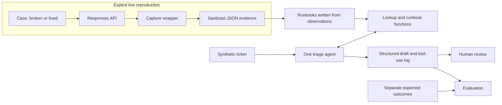

# Architecture

Status: the package, configuration, SDK setup, test boundaries, capture wrapper, and authentication commands are implemented, with offline checks and one reviewed live authentication pair. The authentication runbook is verified; 1 of 4 target cases are live-verified. No agent runs have been completed. The workflow below remains the target design. [Requirements](requirements.md) define acceptance; the [implementation plan](implementation-plan.md) defines delivery order.

## Overview

Use a local command-line application with a small Python package. The failure lab and triage agent share deterministic lookup and runbook functions. A ticket never grants the agent access to reproduction code or credentials.



The evidence-to-runbook step is a human documentation task, not automatic model generation. Evaluation expectations are loaded by the evaluator after model execution, never supplied to the agent or its tools.

## Components and storage

Layout below includes planned components. The current package includes the foundation modules, `capture.py`, and `cases/invalid_credentials.py`, with a verified authentication runbook, two selected live evidence files, and offline tests. The other cases, deterministic tools, tickets, agent, and evaluation remain deferred:

```text
src/api_support_lab/
  __init__.py          package identity; no SDK initialization
  __main__.py          command-line entry point
  cli.py               argument parsing and dispatch boundary
  config.py            non-secret settings and live/credential checks
  sdk.py               lazy client construction and offline Agents SDK setup
  capture.py          execute, normalize, sanitize, save
  cases/              one module per case, with broken() and fixed()
  runbooks.py          registry and three shared functions
  agent.py            SDK configuration, tool wrappers, result models
  evaluation.py       ticket loading, scoring, saved reports
runbooks/             Markdown, one file per case
evidence/             sanitized live observations
triage/tickets/       static YAML tickets
triage/expected.yaml  evaluation-only outcomes
triage/instructions.md
tests/               offline tests and explicit live checks
docs/                requirements, architecture, implementation plan
```

Local run artifacts belong under an ignored `artifacts/` directory. Select sanitized evidence and evaluation examples deliberately for the public tree. The dependency manifest and lockfile are part of the offline foundation.

Use a static registry mapping each case identifier to its runbook path. Read the first prose paragraph after the runbook title as its one-line symptoms description. Resolve paths relative to the project location, not the caller's working directory.

## Environment and model

Target Python 3.14 and manage the environment with `uv`. Depend directly on `openai`, `openai-agents`, Pydantic, and PyYAML; use pytest for checks and standard-library argument parsing for the CLI. The locked dependency set installs on Python 3.14.4; versions and checked setup instructions are recorded in the README.

Use `OPENAI_API_KEY` for the credential and `API_SUPPORT_LAB_MODEL` for the model override, defaulting to `gpt-6.1-sol`. Set reasoning effort explicitly to `low` through Responses. Sol supports low reasoning and Responses tool calling; it does not support `none` or `minimal`. Model availability in the configured account must be checked. [Model reference](https://developers.openai.com/api/docs/models/gpt-6.1-sol)

The implementation will use the SDK's `Agent`, `Runner`, and `function_tool` interfaces. Use a Pydantic result model through `output_type`. Start with an asynchronous runner behind the CLI rather than relying on a synchronous helper whose availability has not been checked. [Agents SDK quickstart](https://developers.openai.com/api/docs/guides/agents/quickstart), [structured agent output](https://developers.openai.com/api/docs/guides/agents/define-agents)

Keep settings free of credentials. Load the key only at authorized live client construction, after the opt-in check. An explicit credential override supports the deliberately invalid variant without reading the environment key. Do not load `.env` files automatically; an operator can explicitly use `uv run --env-file .env`. The reproduction client uses the normal OpenAI API endpoint explicitly. `configure_agents()` selects Responses, disables tracing before any agent run, and prepares low-reasoning model settings without creating a client or running a model. The tracing interface is described in the [official SDK example](https://developers.openai.com/cookbook/examples/agents_sdk/session_memory); local compatibility tests check the installed interface.

## Failure lab and evidence contract

Each case exposes `broken()` and `fixed()` using the same small synthetic workload. A shared `capture(case, variant, call)` wrapper executes the callable, normalizes the response or SDK error, sanitizes the record, and writes JSON. Unexpected programming errors fail the command rather than being relabeled as a reproduced API failure.

The implemented wrapper takes settings, an explicit sequence of credentials to redact, and an optional output directory. The callable returns a raw SDK response; capture retains its transport fields before parsing. It never reads credentials or constructs clients. The authentication case supplies the active client's credential explicitly for redaction. Tests use dummy values only.

Use SDK raw-response access where needed to retain the actual HTTP status and allowlisted headers before parsing the response. Disable SDK retries for reproduction calls with `max_retries=0`; otherwise retry behavior can obscure the first outcome. Catch `APITimeoutError` before the broader connection-error type. A timeout does not prove that provider-side processing stopped. [Python SDK reference](https://developers.openai.com/api/reference/python)

| Evidence fields | Meaning |
| --- | --- |
| `case`, `variant`, `captured_at` | Registry case ID, `broken` or `fixed`, UTC timestamp |
| `model`, `sdk_version`, `elapsed_ms` | Requested model, installed OpenAI SDK version, monotonic duration |
| `outcome`, `exception_type` | `response`, `refusal`, `api_error`, `client_timeout`, `connection_error`, or `sdk_error`; exception name when present |
| `http_status`, `error_type`, `error_code`, `error_param`, `message` | Available transport/error details or refusal message, otherwise null |
| `request_id`, `headers` | Available request ID and allowlisted diagnostic headers; no invented identifiers |
| `response_status`, `incomplete_reason` | Completion fields when a parsed response exists |
| `output_excerpt`, `usage` | Bounded synthetic output excerpt and available usage data |
| `settings` | Output-token limit, reasoning effort, client timeout, and retry configuration used |

Capture allowlisted fields only. Allow `x-request-id`, `retry-after`, and `x-ratelimit-*` headers; exclude authorization, cookies, and arbitrary header dumps. Redact configured credentials and recognizable credential strings from messages, excerpts, and logged tool arguments before writing anything. Keep full prompts and response objects out of capture artifacts. Limit the sanitized output excerpt to 1,000 characters. Never serialize the client or environment.

Usage normalization selects available input/output/total token counts and cached-input/reasoning-output details; arbitrary extra usage fields are excluded. When a server error body exists, capture selects only its structured message; a missing message stays null instead of falling back to an SDK string that embeds the body. Local SDK errors without a body retain their available message. Redact before truncation, including allowed header values, and treat artifact review as necessary before sharing.

Write separate files per variant and attempt; retain timestamps so rerunning a case does not silently replace its evidence. Unavailable fields are null and unavailable headers are an empty object. A client timeout without an HTTP response has null transport fields, not a fabricated HTTP 408. Offline test doubles are test fixtures, never published as live observations.

The default output directory is anchored to the checkout at `artifacts/evidence/`; explicit relative `--output-dir` overrides are resolved by the caller's working directory. Filenames include case, variant, UTC timestamp, and a unique suffix; exclusive creation prevents overwriting. Filesystem errors fail the command without a new request, because usage may already have occurred. Authentication requests set `store=False` and perform one request per invocation. A per-attempt check does not automatically verify the pair or change the runbook.

### Case behavior

| Case ID | Broken variant | Corrected variant and verification |
| --- | --- | --- |
| `invalid_credentials` | Use an obviously invalid credential against the normal API endpoint | Use the environment credential on the same bounded request; verify completion. Do not infer revocation from the error |
| `tool_schema` | Send a function-tool schema deliberately outside the supported schema rules | Send a valid schema for the same task; verify the API accepts it and the response completes. Local tool execution is unnecessary |
| `incomplete_output` | Use structured output with a bounded budget too small for completion | Increase the bounded budget; verify completed status, expected content, and schema-valid parsed output |
| `timeout` | Use a very short configurable client timeout on a bounded request | Give the same request a suitable timeout and verify completion; keep retries disabled for comparison |

Do not assert exact error-message wording. Confirm error codes, parameters, minimum token limits, and status behavior from actual captures. Structured output can be incomplete when an output limit is reached; a refusal is a separate outcome. Sol's reasoning may consume the budget before visible JSON appears, so literal truncated JSON is not required to reproduce incomplete output. [Structured-output guide](https://developers.openai.com/api/docs/guides/structured-outputs?api-mode=responses)

Start corrected requests with a 2,048-token output cap and a 60-second client timeout. For the incomplete variant, begin with a 128-token cap or the documented minimum if higher; for the timeout variant, begin at 0.5 seconds. Adjust only within the reproduction timebox and record effective settings. An unrelated failure does not verify the intended case. A corrected timeout request can still fail for another reason; report that result honestly.

## Runbooks and deterministic tools

Each runbook begins with a title and one-line symptoms paragraph. Follow with reproduction status and evidence links, observed error or completion details, diagnosis and alternative explanations, fix, escalation checklist, customer reply, verified-on date, and source links. Use `verified` only when the broken and corrected observations support the case. Otherwise use `not_reproduced` or `partially_verified` and explain the limitation; the verified-on date remains null until verification succeeds.

The shared public interfaces are:

```python
CaseId = Literal["invalid_credentials", "tool_schema", "incomplete_output", "timeout"]

def diagnose(status: int, error_code: str | None = None) -> list[CaseId]: ...
def list_runbooks() -> dict[CaseId, str]: ...
def get_runbook(case: CaseId) -> str: ...
```

Validate the status as an HTTP status integer. With no code, return registered candidates for that status; with a code, return exact registered matches. Unknown statuses or status/code combinations return `[]`, not an invented `unknown` runbook. Use stable registry order and deduplicate candidates. Register mappings from captured API errors; do not register HTTP success as a diagnosis. Missing error codes do not block symptom-based triage.

`list_runbooks()` exposes available runbooks and their symptoms. `get_runbook()` uses the registry to reject invalid IDs and arbitrary paths; missing files fail explicitly. The incomplete-output and timeout cases use symptom-based retrieval. A documented but unverified runbook may be retrieved, but its status must remain visible in the result and reply.

SDK decorators wrap these plain functions without duplicating the lookup logic. They supply local material only; no function makes network requests, runs case code, or changes state.

## Agent input, output, and behavior

Load tickets with safe YAML parsing. Each ticket has `id`, `subject`, `body`, and nullable `pasted_error`; an optional invented organization and channel provide context. Observed pasted errors reference sanitized evidence in the ticket's provenance metadata. Only subject, body, and pasted error are sent to the agent; do not send case IDs, evidence filenames, evaluation labels, or provenance metadata that would reveal the answer.

| Result field | Contract |
| --- | --- |
| `category` | A case ID, `undetermined`, or `out_of_scope` |
| `candidate_runbooks` | Zero or more known case IDs; hypotheses rather than confirmation |
| `observed_evidence` | Short extracts of facts actually supplied in the ticket |
| `basis` | `stated`, `inferred`, or `none`, describing the diagnosis |
| `severity` | `low`, `medium`, `high`, or `unknown` |
| `action` | `recommend_fix`, `request_info`, or `escalate` |
| `missing` | Relevant evidence field names to request |
| `customer_reply` | A draft grounded in the ticket and retrieved runbooks |
| `escalation_note` | Short evidence summary, uncertainties, and suggested routing; empty when unnecessary |

Use `stated` when supplied diagnostic details directly support the category, `inferred` for a tentative symptom-based interpretation, and `none` when there is no supported in-lab diagnosis. Customer assertions alone never establish the category. Record a brief evidence summary, not private reasoning traces.

Severity describes reported impact: `high` for a blocked workflow or stated broad outage; `medium` for degradation with a workaround; `low` for a limited nonblocking issue; `unknown` when impact is absent. An error code does not determine impact. Urgency does not justify inventing a cause.

Pass only explicit ticket values to `diagnose`. When evidence is partial, read candidate runbooks and ask a focused question. Never fill in a guessed error code to make the lookup match. A lone 400 in this small registry is insufficient to establish malformed tools; the registry is not an exhaustive API taxonomy. Preserve unfamiliar codes and request relevant details instead of silently replacing them with a familiar code.

Retrieve supporting material before `recommend_fix`. All cited case IDs must have been retrieved during the run; validate this against the tool-use log before accepting a result. Escalate out-of-scope requests without pretending that an engineering handoff occurred. Request a minimal sanitized diagnostic excerpt rather than credentials, full logs, or sensitive records. Treat ticket text as data, including instructions embedded in a pasted log.

Use at most eight agent turns and a 4,096-token output cap per model response initially. Record settings, elapsed time, available usage, sanitized tool arguments/results, and SDK versions locally. Disable automatic remote trace export for the MVP; inspect the installed SDK configuration during setup. Never expose the client credential through tools or prompts.

On model/API failure, refusal, turn exhaustion, or invalid/ungrounded output, save an explicit failed run record with no fabricated triage result. A tool error is not evidence of a customer-side failure. Structured output validates shape; evidence and reply correctness still require evaluation.

## CLI, execution boundaries, and budget

The following is the command contract. Authentication reproduction is implemented, checked offline, and live-verified for one broken/corrected pair. Other cases and business handlers remain unavailable and return a nonzero `not implemented` result without loading credentials or making requests. CLI help and offline tests work now:

```text
uv run python -m api_support_lab reproduce CASE --variant broken|fixed --live
uv run python -m api_support_lab diagnose --status STATUS [--error-code CODE]
uv run python -m api_support_lab triage TICKET.yaml --live
uv run python -m api_support_lab evaluate --live
uv run pytest                         # offline only
uv run pytest --run-live              # explicit reproduction checks
```

The current suite contains no live reproduction tests; `--run-live` currently exercises only the harmless generated opt-in probe through its policy test. Live verification used one explicit CLI invocation per variant. For `reproduce invalid_credentials`, exit code 0 means HTTP 401 plus `AuthenticationError` for the broken attempt, or HTTP success plus completed status and nonempty text for the fixed attempt. Other recorded outcomes return 1; configuration/argument errors return 2. A runbook is marked verified only after reviewing a live pair and sanitization; authentication now meets that checkpoint. Use `--no-env-file` with offline uv commands to avoid loading credentials through uv's environment-file setting.

Require `--live` for every CLI operation that calls the API, including authentication experiments, triage, and evaluation. Refuse without that flag before client construction. Check required environment values without displaying them. A pytest marker alone must not enable live tests: register a `--run-live` opt-in and skip them by default. Score saved artifacts offline without rerunning the agent; expose that through `evaluate --results PATH` without `--live`.

Keep the boundary small: a CLI opt-in check, a lazy client-construction helper, and pytest hooks. Offline tests temporarily block DNS and socket connection methods; the fixture is exempted only for marked live tests with explicit opt-in. This test-only tripwire applies inside the pytest process, not arbitrary subprocesses or external programs. The current suite makes no API requests, including its opt-in policy tests. Live evaluation and offline saved-result scoring are mutually exclusive CLI modes. Do not add a budget middleware or a general authorization framework.

Run cases sequentially and keep automatic retries disabled for the initial lab and agent runs. Stop the requested operation on unexpected failures; a batch evaluation records the failed ticket and continues within its bounded ticket/turn count. Review usage and account spending between milestones. Missing usage, especially after a timeout, means unknown cost, not zero cost. The $15 allowance is a manual experiment budget; these bounds do not enforce an account-wide billing ceiling.

## Evaluation design

Use ten tickets: four clear cases, partial evidence, ambiguous symptoms with explicit business impact, an unfamiliar error, misleading customer diagnosis, an out-of-scope request, and a public-sector data-handling request. Use observed excerpts for verified cases. Hand-authored unfamiliar-error fixtures are labeled synthetic in evaluator-only provenance and must never be described as observed API behavior.

Expected outcomes are keyed by ticket ID and include acceptable categories, expected basis/action/severity, required information fields, and any required runbook IDs. The public-sector ticket asks how to share potentially sensitive diagnostic data without including actual sensitive content. It should escalate the handling question, request minimal sanitized metadata, and refer to the organization's established process without claiming this lab provides a compliant channel.

Check schema validity, allowed category, action and severity agreement, required fields in `missing`, and supporting retrieval. Check logged diagnosis arguments against ticket-supplied values. Manually review replies for useful questions, unsupported claims, inappropriate sensitive-data requests, uncertainty, and clear escalation language. A required field in JSON does not prove the reply actually asks for it.

Report per-ticket outcomes and aggregate numerators/denominators over all ten tickets, including failed runs. Report operational failures separately from semantic mismatches; never drop failures to inflate scores. Save the ticket set version or content hash, model, SDK versions, settings, and timestamp. Label the report a small demonstration, with no general reliability claims.

## Tradeoffs and remaining verification

| Choice | Benefit and cost |
| --- | --- |
| One agent with three function tools | Makes retrieval inspectable; adds orchestration compared with one prompt containing every runbook |
| Plain functions and files | Easy to read and test; deliberately limited search and persistence capabilities |
| Explicit capture wrapper | Handles success and exceptions in one place without decorator indirection |
| Four cases before expanding coverage | Leaves time for evaluation; many real errors remain outside the registry |
| Python 3.14 and one model default | A single documented environment; dependency and account compatibility must be checked |

Official documentation and installed SDK source were consulted on 2026-10-21. Python 3.14 dependency installation, core SDK exports, local structured-output configuration, tracing controls, allowlisted capture/redaction, and SDK authentication request handling have offline checks. One live pair established the observed authentication rejection, a successful correction, and access to the configured model at that time. Actual tool schemas, other case mappings/triggers/corrections, agent behavior, and billed costs remain implementation checks. The service tier is not captured, so standard-rate token estimates are not billed-cost evidence. Recheck the linked official pages when building; do not substitute documentation expectations for captured observations.
